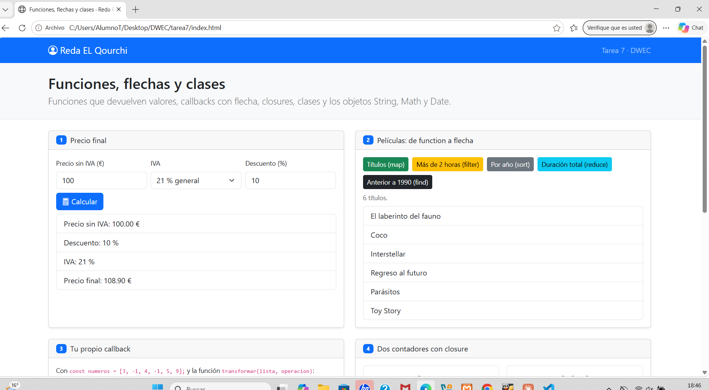
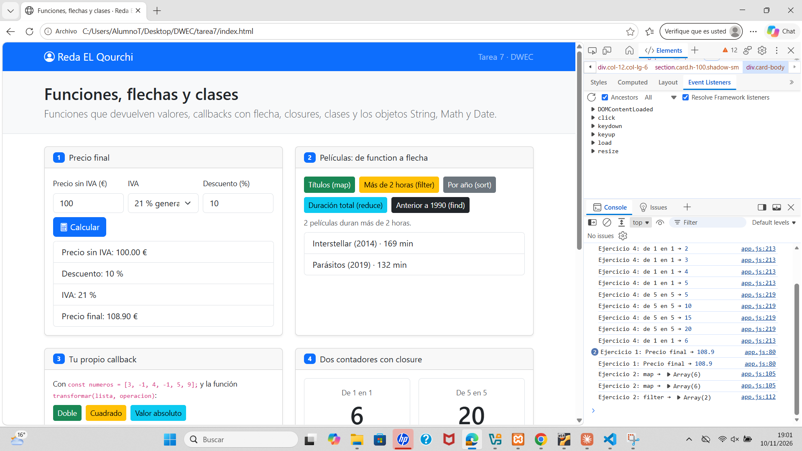
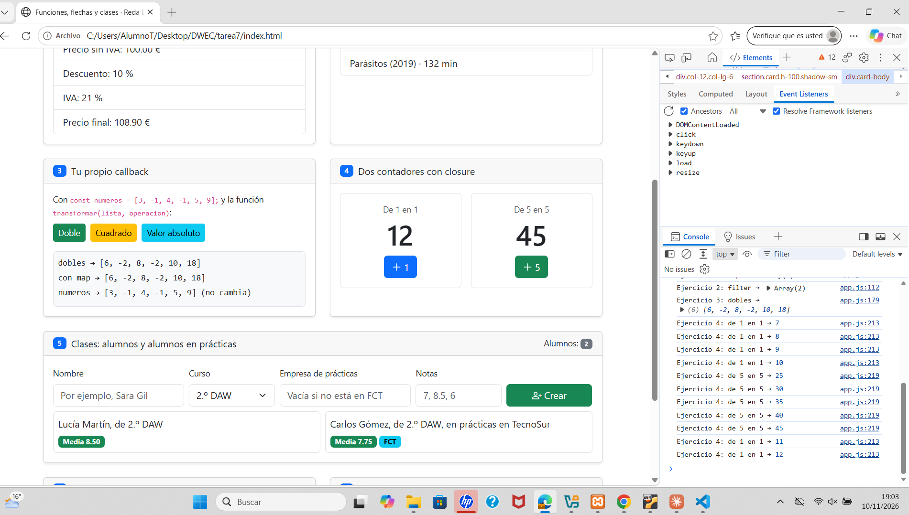
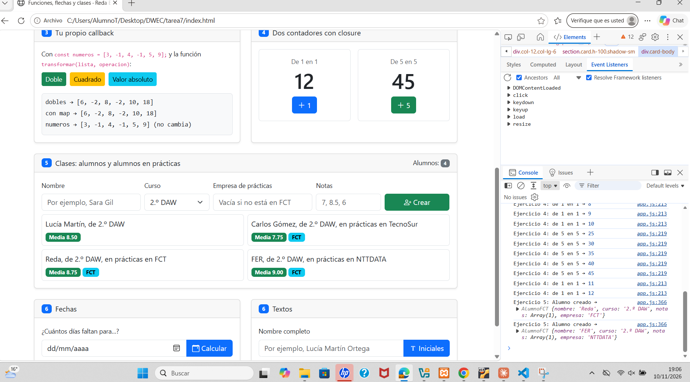
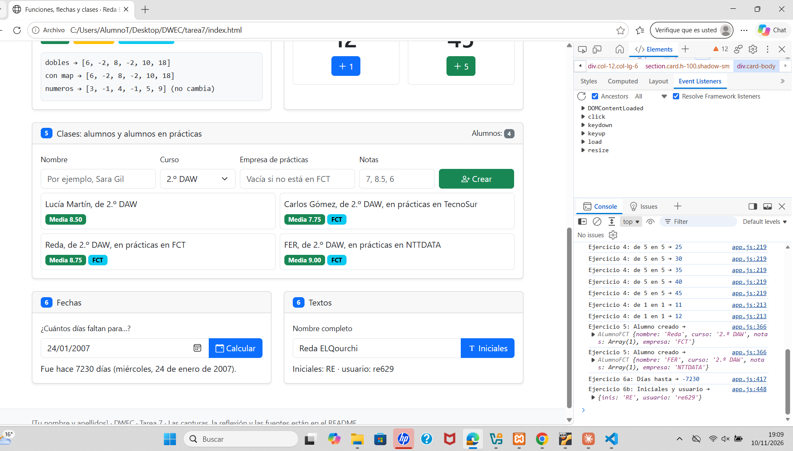

# Tarea 7 · Funciones, flechas y clases

Reda ElQourchi · DWEC 26/27

## Capturas

### Captura 1. Página recién cargada

[1-2 líneas: qué se ve, por ejemplo tu nombre en la navbar y la página sin resultados todavía.]

### Captura 2. Precio con descuento y películas

[Qué precio calculaste (base, IVA, descuento), qué resultado salió y qué botón de películas pulsaste.]

### Captura 3. Callback y contadores

[Qué botón de transformar pulsaste, qué valor tienen los dos contadores y por qué son distintos.]

### Captura 4. Alumnos

[Cuántos alumnos hay, cuáles creaste tú y cuál está en prácticas.]

### Captura 5. Fechas e iniciales

[Qué fecha pusiste, cuántos días salieron y qué nombre probaste con espacios dobles.]

## Ejercicio 4: por qué los contadores no se mezclan
[Explícalo con tus palabras: cada llamada a crearContador() crea su propia variable cuenta,
y la función que devuelve la recuerda. Di también qué pasa al escribir cuenta en la consola
y por qué.]

## Reflexión (5-8 líneas)
[Responde a las tres preguntas con un ejemplo de TU app.js:
- ¿Qué cambia al pasar un callback de function a flecha?
- ¿Cuándo hace falta el return?
- ¿Por qué un método no se escribe con flecha?]

## Fuentes consultadas
- MDN · Funciones flecha: https://developer.mozilla.org/es/docs/Web/JavaScript/Reference/Functions/Arrow_functions
- MDN · Closures: https://developer.mozilla.org/es/docs/Web/JavaScript/Guide/Closures
- MDN · Clases: https://developer.mozilla.org/es/docs/Web/JavaScript/Reference/Classes
- [Añade los apuntes del tema 7 u otras páginas que uses.]

## Uso de IA
He usado Claude (Anthropic) para [orientarme con el enunciado / revisar mi código /
revisar la redacción del README]. [Qué hiciste después con sus respuestas, por ejemplo:
corregí X en el ejercicio 5 y lo probé en la consola.]
```