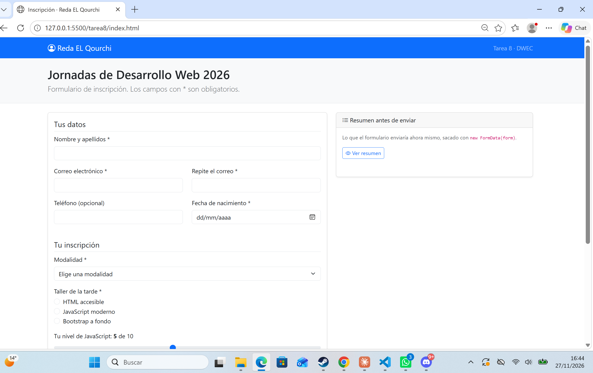
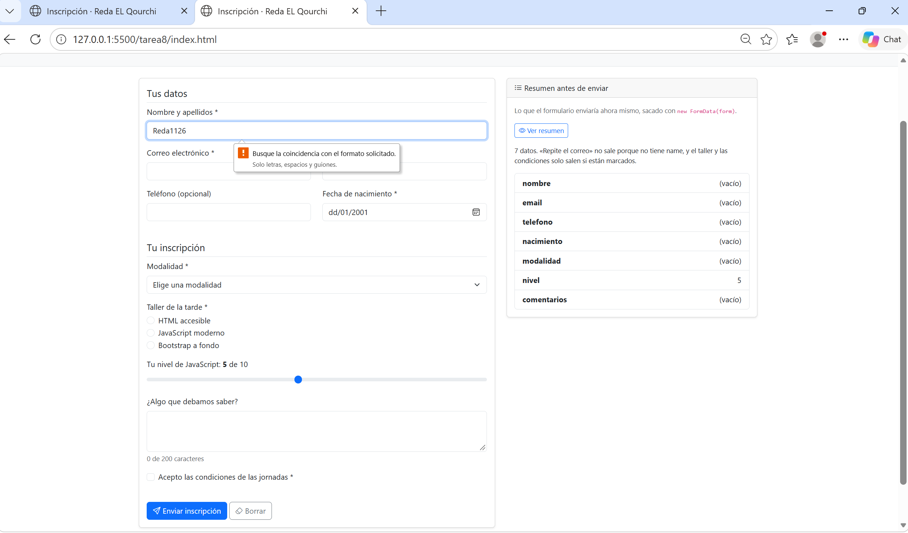
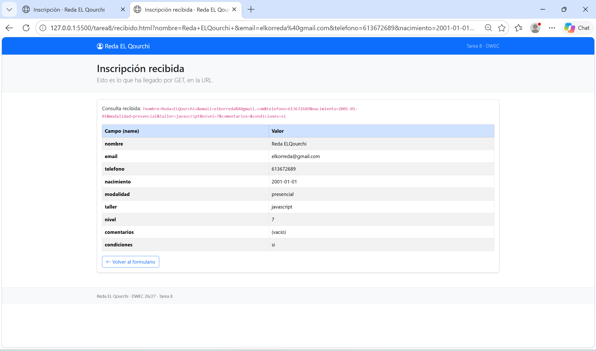
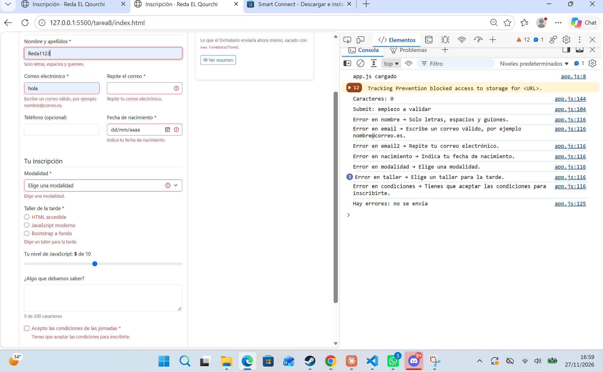
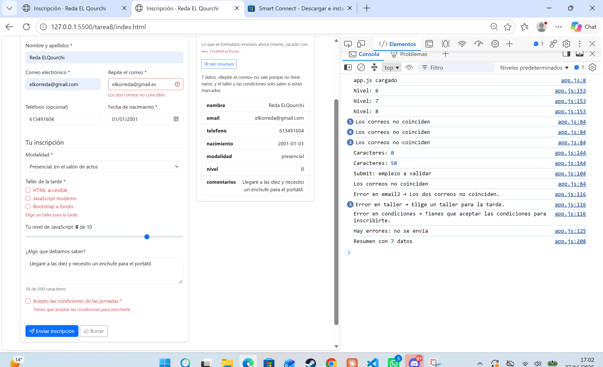

# Tarea 8 · Formulario de inscripción

**Autor:** Reda EL Qourchi · Desarrollo Web en Entorno Cliente (DWEC) · 2.º DAW · Curso 2026-27

Formulario de inscripción a las «Jornadas de Desarrollo Web 2026» con Bootstrap, validación HTML5 y con JavaScript, y una página `recibido.html` que enseña lo que llega por GET. Para probarlo: abrir la carpeta en VS Code, pulsar **Go Live** y abrir `index.html` con la consola abierta (F12).

## Capturas

### a) La página recién cargada

Mi nombre en la navbar y el formulario con sus dos fieldset, «Tus datos» y «Tu inscripción», y la tarjeta del resumen a la derecha.

### b) Ejercicio 2: el mensaje del navegador

Sin `novalidate`, escribí `Reda1126` en el nombre y el navegador no deja enviar: el `pattern` solo acepta letras, y el mensaje sale del `title`. Después quité con F12 el `required` del correo, lo dejé vacío y el formulario se envió sin correo. Por eso el servidor tiene que validar siempre: cualquiera puede cambiar el HTML desde su navegador.

### c) Ejercicio 3: lo que llega por GET

Con GET, todos los datos viajan en la URL después del `?`, como pares `name=valor` separados por `&`. Los espacios se ven como `+` y la `@` como `%40`. «Repite el correo» no llega porque no tiene `name`. Nunca mandaría una contraseña por GET, porque quedaría a la vista en la barra, en el historial y en los registros del servidor.

### d) Ejercicio 4: los errores, junto a cada campo

Con `novalidate`, valido yo con JavaScript y enseño cada error debajo de su campo, sin `alert()`. Los campos vacíos sacan su texto del objeto `OBLIGATORIOS`, el nombre con números saca el `title` (`patternMismatch`) y el correo `hola` da `typeMismatch`. El foco va al primer campo que falla.

### e) Ejercicios 5 y 6: eventos y resumen

El contador marca 58 de 200 y el nivel 8, los dos con el evento `input`. Los correos distintos dan el error de `setCustomValidity`. A la derecha, el resumen sacado con `new FormData(form)`.

## Reflexión

Validando con JavaScript decido yo cómo y dónde se ven los errores: todos a la vez, debajo de cada campo y con mis propios mensajes, en vez del globito del navegador, que solo enseña uno. Además puedo hacer comprobaciones que HTML no tiene, como que los dos correos coincidan. Pero ninguna de las dos validaciones basta sola, porque las dos ocurren en el navegador del usuario, y con F12 se pueden quitar. El servidor tiene que volver a comprobarlo todo. Por último, si el manejador del `submit` es una función flecha, `this` no es el formulario, sino `window`, porque las flechas no tienen su propio `this`. Por eso uso `e.target`.

## Fuentes

- [MDN · Validación de formularios](https://developer.mozilla.org/es/docs/Learn/Forms/Form_validation)
- [MDN · FormData](https://developer.mozilla.org/es/docs/Web/API/FormData)
- [MDN · URLSearchParams](https://developer.mozilla.org/es/docs/Web/API/URLSearchParams)
- [MDN · setCustomValidity()](https://developer.mozilla.org/en-US/docs/Web/API/HTMLInputElement/setCustomValidity)
- [Bootstrap 5.3 · Validation](https://getbootstrap.com/docs/5.3/forms/validation/)

## Uso de IA

He usado Claude (Anthropic) para orientarme con Git y VS Code, para que me explicara el enunciado y para generar parte del código del formulario y de `app.js`. Después lo he probado en el navegadore con la consola abierta, he hecho yo las capturas y he repasado cada parte para entender lo que hace.
