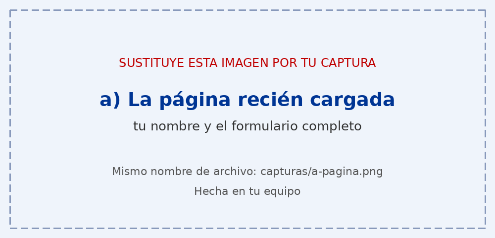
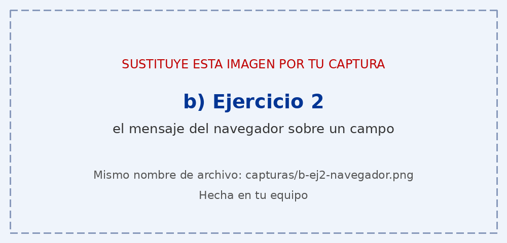
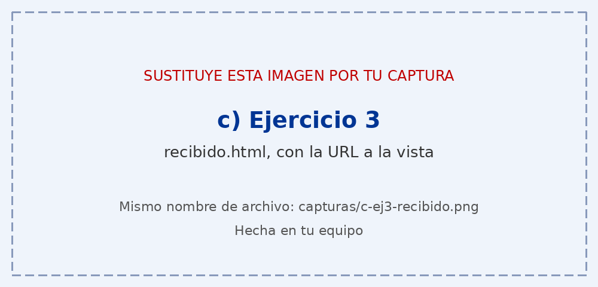
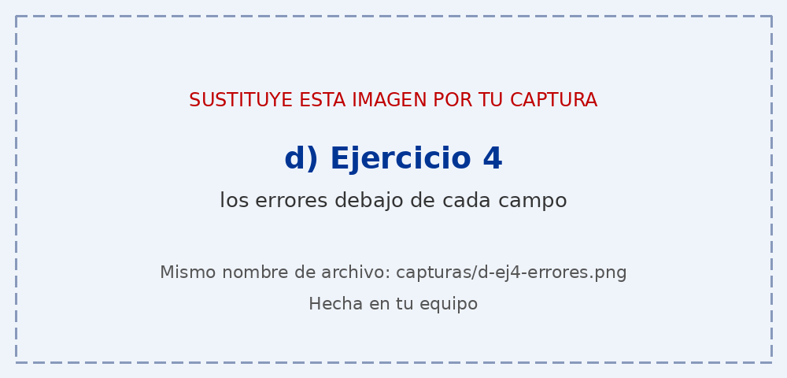
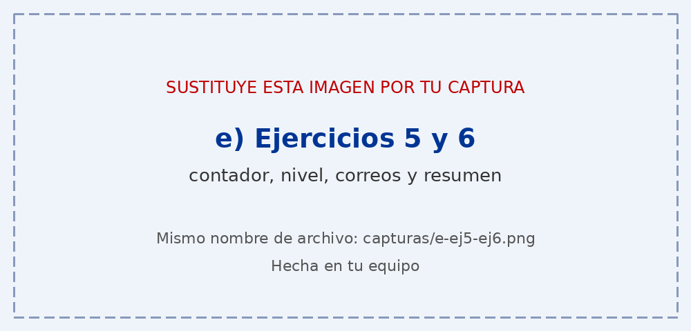

# Tarea 8 · Formulario de inscripción

**Autor:** [Tu nombre y apellidos] · Desarrollo Web en Entorno Cliente (DWEC) · 2.º DAW · Curso 2026-27

> **Plantilla de la tarea 8.** Cómo usarla:
>
> 1. Copia esta carpeta en tu repositorio de DWEC y cámbiale el nombre a `tema08`.
> 2. Esta vez el formulario lo maquetas tú: `index.html` solo trae el primer campo, «nombre», como modelo. Los `id` que usa el JavaScript están en el enunciado.
> 3. `js/app.js` trae `mostrarError()` hecha y el resto con `TODO`; `js/recibido.js`, la lectura de un dato como modelo.
> 4. Flechas en los callbacks y, dentro de ellos, `e.target` en vez de `this`. Nada de `alert()`.
> 5. Sustituye las imágenes de `capturas/` por las tuyas, **con el mismo nombre**.
> 6. Todo lo que va entre [corchetes] es un hueco: cámbialo por lo tuyo. Al terminar, borra este aviso.

[Una o dos líneas: qué hay en esta carpeta y cómo se ve. Por ejemplo: abrir la carpeta en VS Code, pulsar **Go Live** y probar el formulario con la consola abierta (F12).]

## Capturas

### a) La página recién cargada

[Tu nombre y el formulario completo, con sus dos fieldset.]

### b) Ejercicio 2: el mensaje del navegador

[Qué campo falla y qué dice el navegador. Qué pasó al quitar un required desde F12 y por qué hay que validar también en el servidor.]

### c) Ejercicio 3: lo que llega por GET

[Con la barra de direcciones a la vista. Qué viaja en la URL, qué campo no llega y por qué nunca mandarías una contraseña por GET.]

### d) Ejercicio 4: los errores, junto a cada campo

[Al menos cuatro errores distintos y de dónde sale cada mensaje.]

### e) Ejercicios 5 y 6: eventos y resumen

[El contador y el nivel después de escribir, el error de los correos y el resumen de FormData.]

## Reflexión

[De 5 a 8 líneas: ¿qué ganas validando con JavaScript en vez de dejarlo al navegador? ¿Por qué ni una ni otra bastan sin validar también en el servidor? ¿Qué pasa con `this` si el manejador del submit es una flecha?]

## Fuentes

- [Título de la página](https://enlace-a-la-fuente)

## Uso de IA

[Si has usado IA: qué herramienta, para qué y qué hiciste después con su respuesta. Si no la has usado, borra este apartado.]
